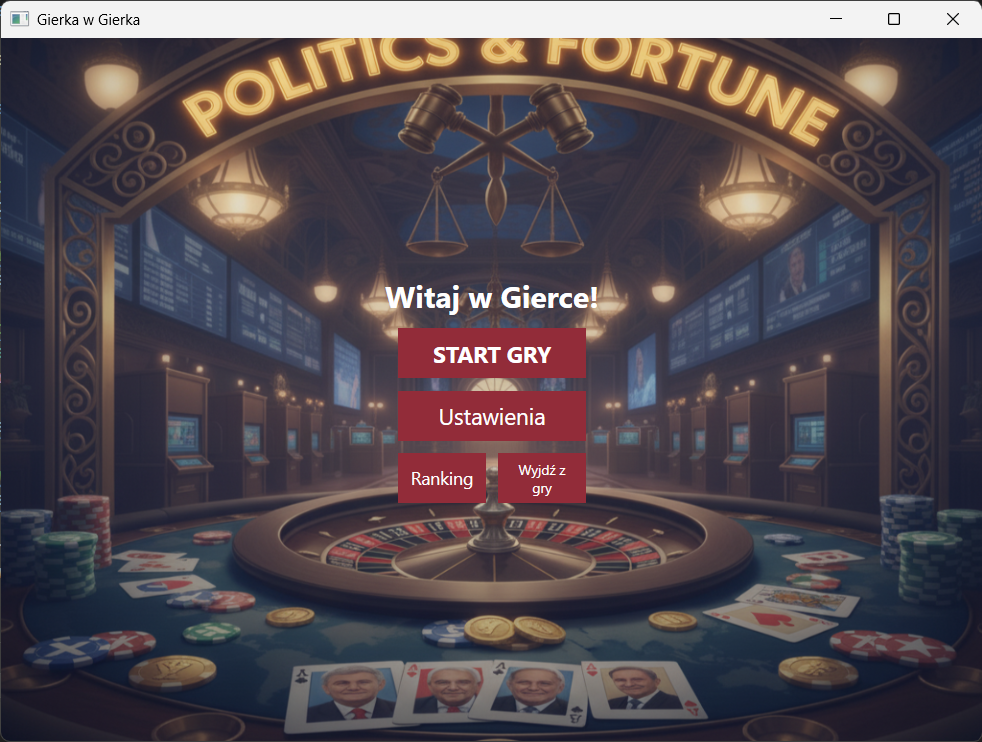
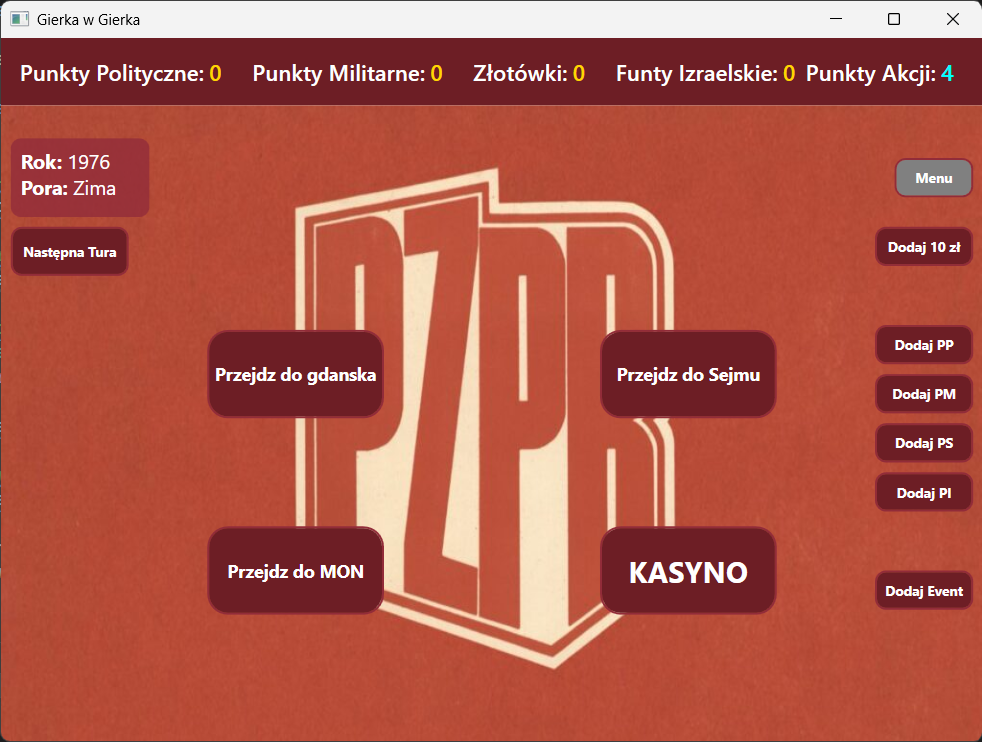
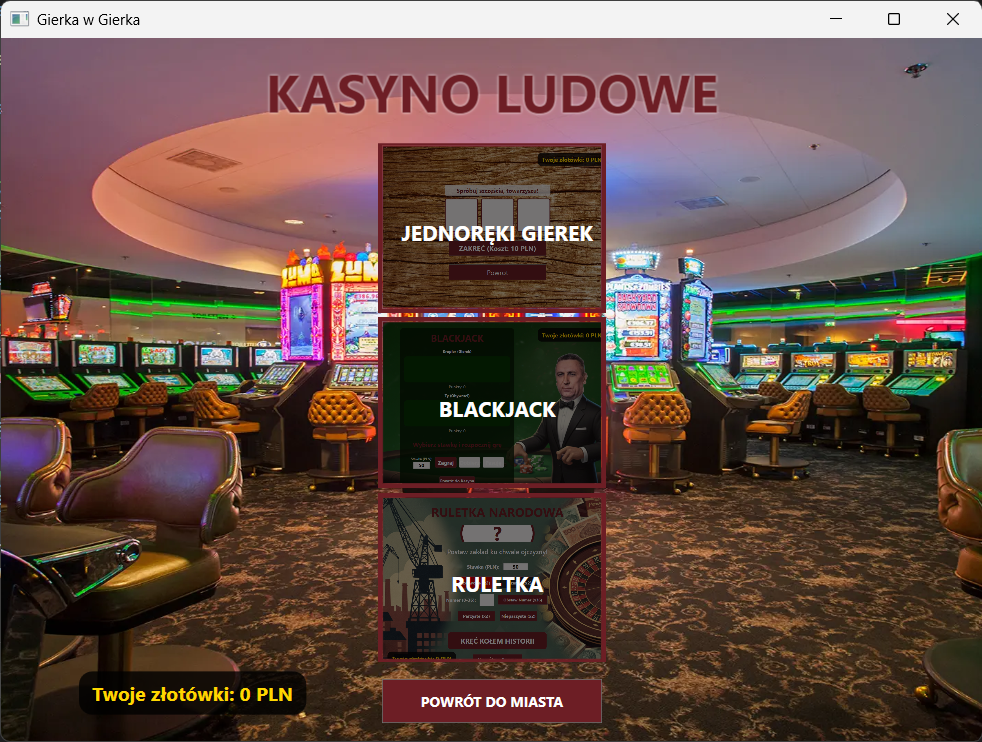

# Gierka - C# WPF Game 🎮

A rich, interactive desktop game application built using **C#** and **WPF (Windows Presentation Foundation)**. This project was developed as a university assignment by a team of three students, demonstrating our ability to build a comprehensive desktop application with a structured architecture, database integration, and an engaging user interface.

## 🌟 Key Features

* **Multi-layered Architecture:** Clean separation of concerns with `Gierka.Core` (logic, database contexts), `Gierka.UI` (views and XAML logic), and `Gierka.Tests` (unit testing).
* **Minigames & Casino:** Fully functional casino module including:
  * **Blackjack:** Card game against the dealer.
  * **Roulette:** Betting on colors/numbers.
  * **Slot Machine (Jednoręki Gierek):** A custom-styled slot machine experience.
  * **Flappy Plane:** A physics-based minigame.
* **Story & Exploration:** Navigatable locations (Sejm, Gdańsk) with an interactive quest system and dialogues.
* **Database Integration:** Local data persistence utilizing **Entity Framework Core (SQLite)** to store game state, user progress, and rankings.
* **Media & Multimedia:** Embedded audio tracks and dynamic UI changes based on in-game actions.
* **Custom Settings:** Fully adjustable resolutions and volume control.

## 🛠️ Technology Stack
* **Language:** C# 12.0
* **Framework:** WPF (.NET 8.0)
* **Database:** SQLite & Entity Framework Core
* **Testing:** xUnit / NUnit (Gierka.Tests)

## 🚀 How to Run

1. Clone the repository.
2. Open `Gierka.sln` in **Visual Studio 2022**.
3. Build the solution to automatically restore NuGet packages (like Entity Framework).
4. **Initialize the Database:** Open the **Package Manager Console** (`Tools -> NuGet Package Manager -> Package Manager Console`), set the Default project to `Gierka.Core`, and run:
   ```powershell
   Update-Database
   ```
5. Set `Gierka.UI` as the Startup Project and run the application (F5).
6. The local SQLite database (`gierka.db`) will be automatically utilized.

## 🤝 Team
This project was proudly created as a collaborative effort by a team of 3 students (including myself) as a final project for our Software Engineering course.

## 📸 Screenshots


<br><br>

<br><br>
