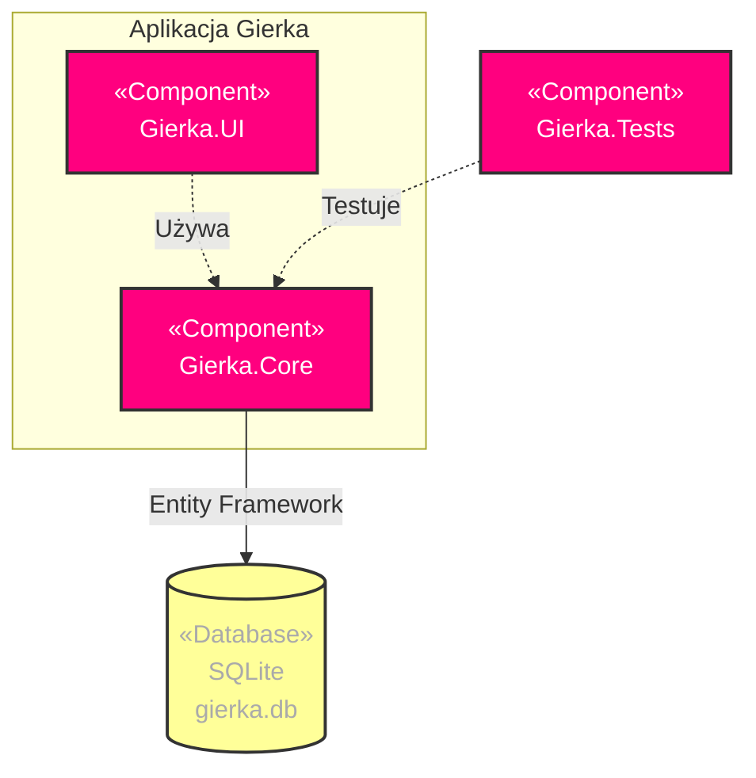
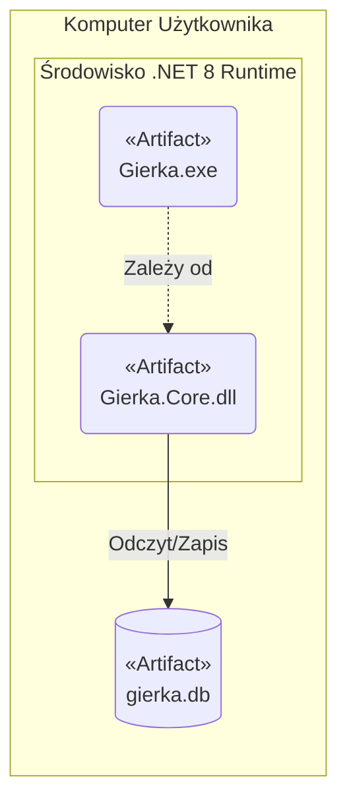
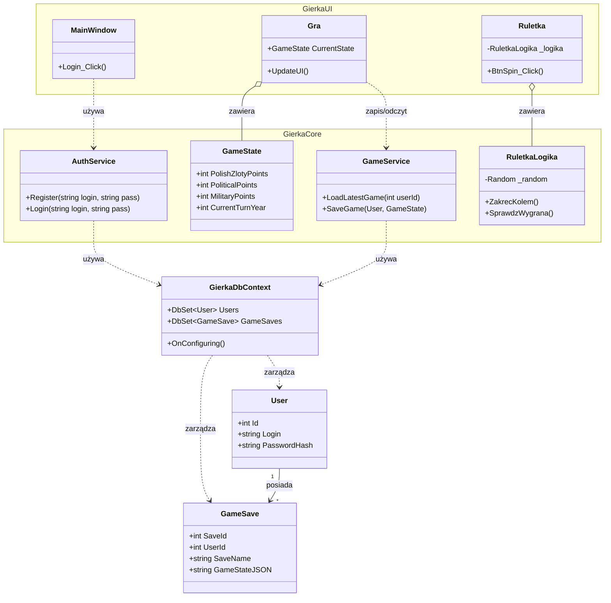

# Architektura i Wdrożenie (Architecture & Deployment)

## Diagram Komponentów
Przedstawia podział aplikacji na moduły (`Gierka.UI`, `Gierka.Core`, `Gierka.Tests`) oraz komunikację z bazą danych SQLite za pośrednictwem Entity Framework.

## Diagram Wdrożenia
Obrazuje fizyczne artefakty wdrożeniowe działające w środowisku uruchomieniowym .NET 8 Runtime na komputerze użytkownika.

## Diagram Klas
Zawiera strukturę klas podzieloną na przestrzenie nazw `GierkaUI` oraz `GierkaCore`, kontekst bazy danych `GierkaDbContext` oraz modele encji (`User`, `GameSave`).

