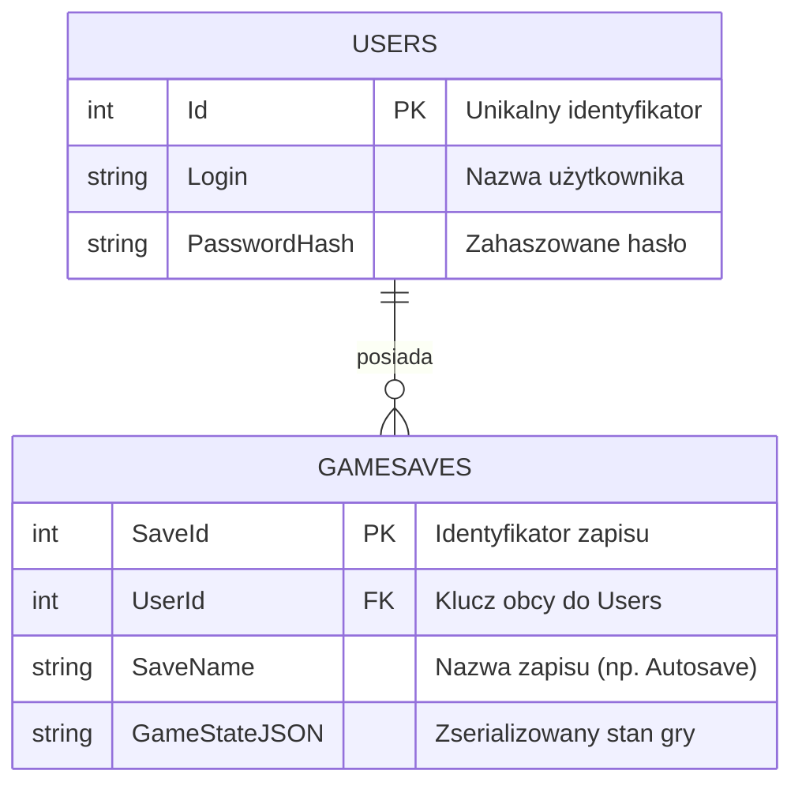
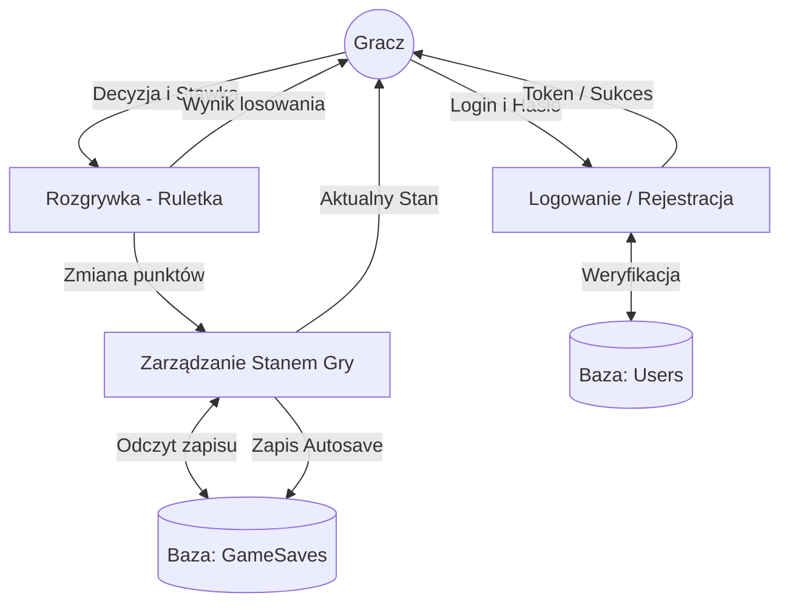

# Baza Danych i Przepływ Danych (Database & Data Flow)

## Diagram ERD – Model Danych
Przedstawia schemat relacyjny tabel `USERS` oraz `GAMESAVES` w relacji jeden-do-wielu wykorzystywany przez Entity Framework.

## Diagram Przepływu Danych (DFD)
Pokazuje przepływ informacji pomiędzy graczem, modułem rozgrywki, autoryzacją, stanem gry a bazami danych.

