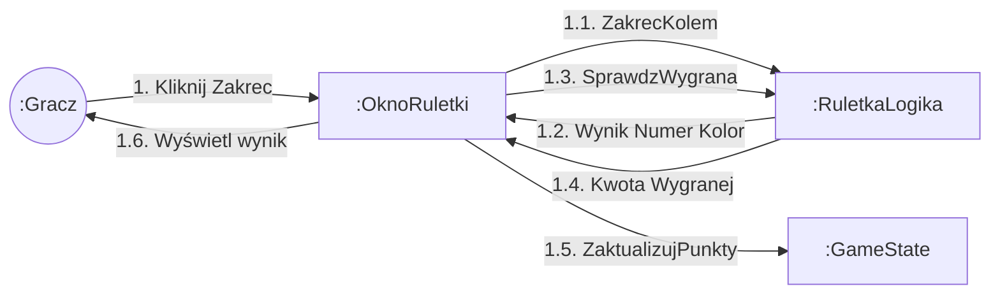
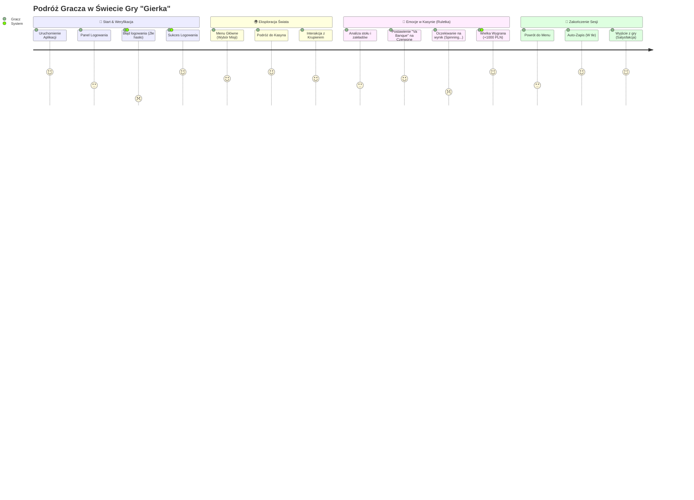

# Przypadki Użycia i Doświadczenie Użytkownika (UX & Use Cases)

## Diagram Komunikacji – Gracz kręci ruletką
Sekwencja wywołań metod pomiędzy interfejsem okna ruletki, logiką losowania a obiektem stanu gry.

## Podróż Gracza (User Journey)
Ścieżka doświadczeń użytkownika (UX) oraz interakcji z systemem podzielona na 4 etapy rozgrywki.

