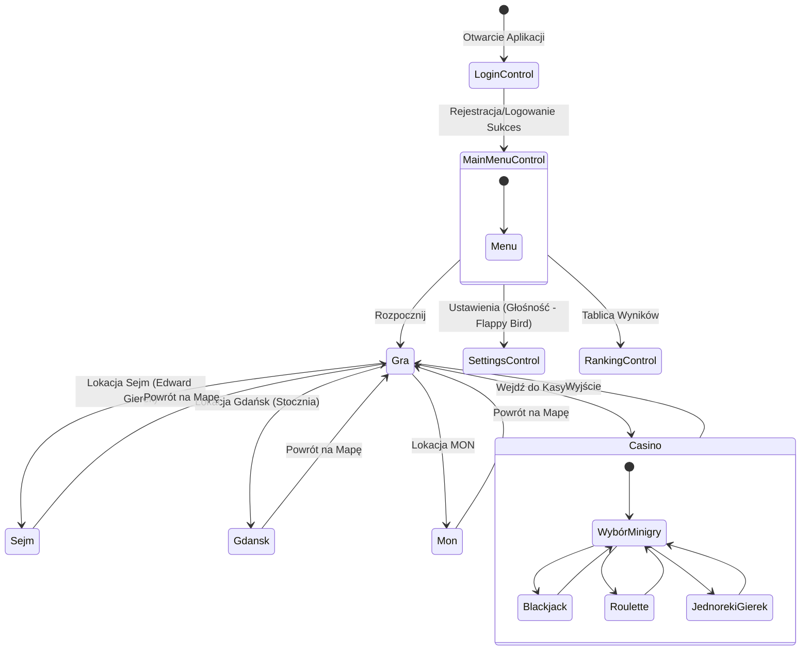

# Nawigacja i Stany Interfejsu (UI State Machine)

Diagram przedstawia architekturę nawigacji (`Navigation`) wewnątrz `MainWindow`. Pokazuje w jaki sposób główne moduły WPF i ekrany gry komunikują się i wymieniają widoki podczas rozgrywki (np. przechodzenie między mapą główną a minigrami w Kasynie).

